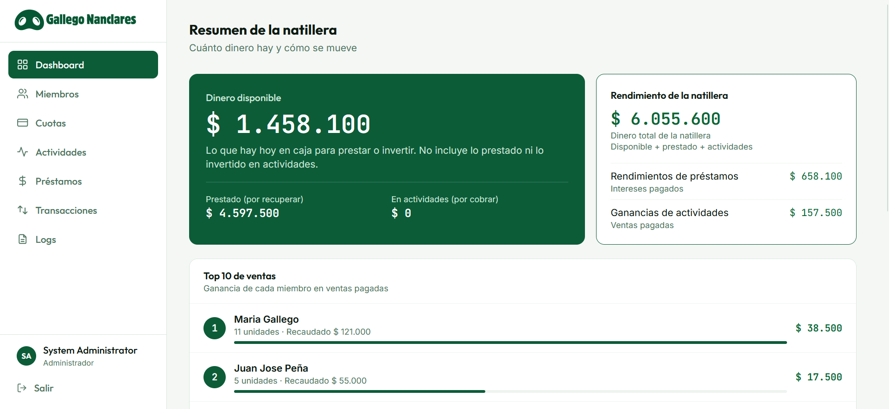
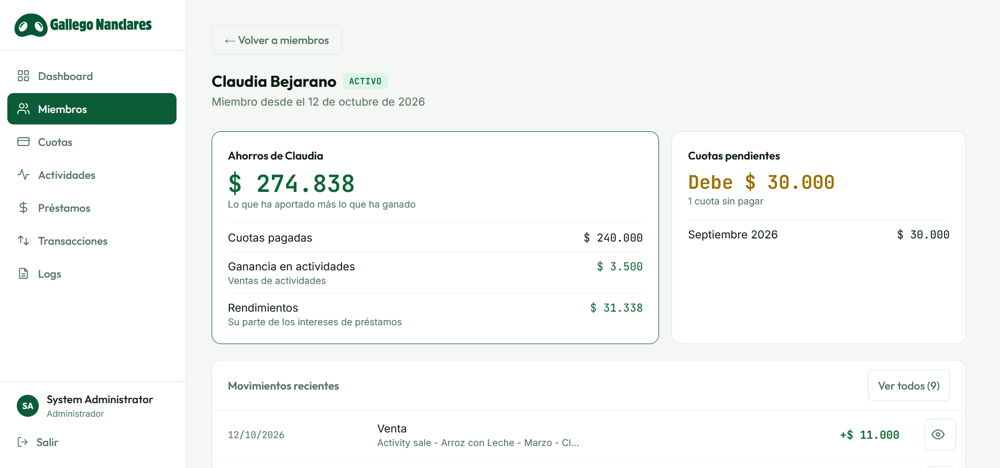
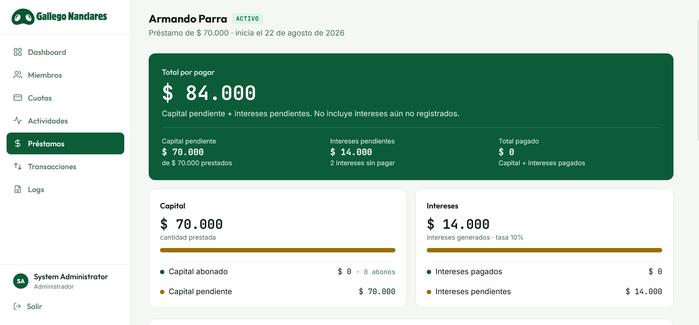
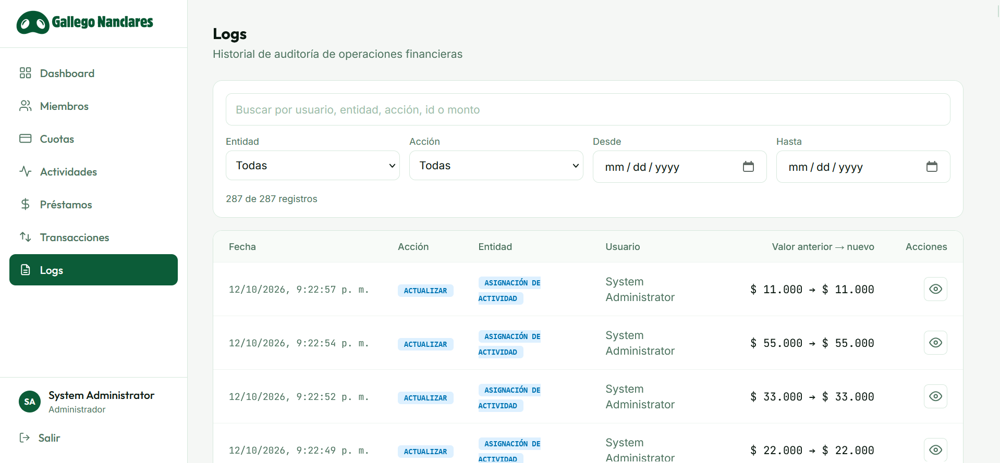

<p align="center">
  <picture>
    <source media="(prefers-color-scheme: dark)" srcset="Natillera.Frontend/public/logo-gallego-nanclares-invertido.png" />
    
  </picture>
</p>

<h3 align="center">Natillera Gallego Nanclares</h3>
<p align="center"><em>Familia que ahorra junta, prospera junta.</em></p>

<p align="center">
  <a href="https://natillera-web.onrender.com"><strong>👉 See the live app: natillera-web.onrender.com</strong></a>
</p>

<p align="center">
  <a href="https://natillera-web.onrender.com"></a>
  <a href="https://github.com/JeritoBa/Natillera/actions/workflows/ci.yml"></a>
</p>

<p align="center">
  
  
  
  
  
  <br />
  
  
  
  
  
  <br />
  
  
  
  
  
</p>

<p align="center">
  
  <br />
  <sub>Admin dashboard: every figure is derived from the transaction ledger, never typed in by hand. Sample data.</sub>
</p>

---

> **This is not an open-source project.** The source code is private property of its owner and is shared here only to describe what the application is, how it works and how it is built. No license is granted to use, copy, modify or distribute it. All rights reserved.

## Latest version: v1.1.1

- **Admin dashboard:** the total money of the natillera now shows where it comes from (paid fees, net activity earnings and loan returns) with a proportion bar, and a new **"Pendientes por cobrar"** table lists what each member owes, filterable by kind (fees, loan principal, interest, activity sales) with links to the matching lists.
- **Fee ledger:** the member detail and the member dashboard show the 12 months of the period at a glance (paid, pending, no fee, upcoming), each paid month linked to its fee.
- **Clearer forms and confirmations:** form errors always scroll into view, and every "Anular" action opens the app's own confirmation dialog with its consequences; if the server rejects it, the reason is shown right there.
- **Filters:** every list keeps its filters in the URL (they survive a reload and can be shared), status counts follow the other filters, and cancelled records (and inactive members) are hidden unless you choose the "Anulados" (or "Inactivos") filter. Loan and activity details hide cancelled rows behind "Ver anulados".
- **Pagination:** transactions and the audit log are paginated and filtered on the server (50 per page), so they load fast as the data grows.
- **Activities:** an assignment can be created already paid, registering the sale income in one step.
- **Loans:** the interest rate and description can be corrected at any time; once a loan has payments or interest, its amount, borrower and start date stay locked.
- **Fixes:** the dashboard no longer scrolls into an empty white area, and the loans list has a borrower filter.

<details>
<summary>v1.1.0</summary>

- **Saving periods:** the natillera runs by years. In the new **Configuración** view (gear icon) every user picks the year to see; the selected year is always shown on screen and the choice is remembered on each device (default: the current year). Every figure, list and check is computed within that year and each year starts from zero.
- **Loan description:** an optional note of up to 500 characters on each loan, with a character counter in the form and its own card in the loan detail.
- **Activity extra costs:** the Admin records the extra costs of an activity (e.g. delivery) as pending or paid from the activity detail. Paid extra costs are subtracted from the loan interest shared among the members, and a cost that exceeds that interest or the available money is rejected.
- **Safer API errors:** every error the API returns uses the app's own message format; framework error pages and internal details are never sent.

</details>

<details>
<summary>v1.0.1</summary>

- **Pending obligations:** the member detail page and the member dashboard show everything a member still owes (fees, loan principal, interest and activity sales), grouped by kind and linked to each record.
- **Filters:** monthly fees by member, month and status; loans by borrower and status; members by name and status; transactions by type and month.
- **Fixes:** cancelled transactions are no longer counted in the income and expense totals, and they show as "Anulado"; the fee form offers only the months a member has not paid yet.
- **Mobile, tablet and desktop:** one consistent table layout and centred stat cards, so every list stays readable on any screen; forms can be submitted with Enter.

</details>

## Take a look

The application is live at **[natillera-web.onrender.com](https://natillera-web.onrender.com)**. Anyone can visit the public landing page to learn what a natillera is, how a month works and what members see when they log in (all example figures there are fictitious). Want to join? Use the **"Quiero unirme"** button to write to the natillera on WhatsApp.

**Try it without an account:** open the **[public demo](https://natillera-web.onrender.com/demo)** and browse the whole system as the administrator or as a member. The demo runs entirely in your browser with fictitious data: it never calls the API, and nothing you do there is saved.

Members and the administrator log in with the email and password given by the administrator; real financial data is only visible after logging in.

> Hosted on free tiers (Render + Neon): if nobody has used it for a while, the first visit may take up to a minute while the server wakes up.

## Screenshots

<table>
  <tr>
    <td width="33%" valign="top">
      <a href="docs/app_screenshots/member-detail.png"></a>
      <p><strong>Member detail</strong><br /><sub>Savings broken down into paid fees, activity earnings and share of loan interest, plus pending fees and the member's movements.</sub></p>
    </td>
    <td width="33%" valign="top">
      <a href="docs/app_screenshots/loan-detail.png"></a>
      <p><strong>Loan detail</strong><br /><sub>Outstanding principal and interest at a glance; a payment can never exceed what is still owed.</sub></p>
    </td>
    <td width="33%" valign="top">
      <a href="docs/app_screenshots/audit-log.png"></a>
      <p><strong>Audit log</strong><br /><sub>Every create, update and cancel is recorded with its old and new value and the user who made it.</sub></p>
    </td>
  </tr>
</table>

<sub>All screenshots use sample data from the development environment; no real member data is shown.</sub>

## What is it?

A **natillera** is an informal, community-based savings and lending group, very common in Colombia. Every month each member contributes a fixed fee into a common fund. That money is lent back to members at an agreed interest rate and invested in products that the group sells together. The earnings stay in the group and are shared among its members.

This application replaces the phone note and the generic money app that the Gallego Nanclares family used to run their natillera, which produced inconsistent balances. Its core value is **financial data integrity**: every peso that comes in or goes out is recorded, traceable and never silently deleted, and every balance is derived from those records instead of being typed in by hand.

## Features

| Area | What it does |
|---|---|
| **Authentication** | JWT login with two roles: **Admin** (manages the natillera) and **Member** (read-only). Inactive users cannot sign in, and their open sessions stop working immediately. |
| **Dashboard** | Available money in the fund, total balance, loan and activity earnings, each member's savings (paid fees + activity earnings + share of interest), pending-fee reminders, top 10 sellers and recent movements. |
| **Members** | Create, edit, activate and deactivate members. A member with pending obligations (fees, loans, interest or activity assignments) cannot be deactivated. Detailed view with savings, pending fees and transaction history. |
| **Monthly fees** | Register fees as *Pending* or *Paid*, mark them as paid and cancel them. One active fee per member and month. |
| **Loans** | Loans to members with principal payments and interest records. A payment can never exceed the outstanding principal; a loan is settled automatically when its principal and pending interest reach zero. |
| **Activities** | Group sales: the fund buys units, assigns them to members and records each sale when it is paid. Tracks cost, outstanding collections, gross and net profit. An activity closes only when all its units are assigned and paid. |
| **Transactions** | Complete, filterable ledger of incomes and expenses. Each business entity owns exactly one transaction. |
| **Audit log** | Admin-only history of every create, update and cancel, with the old and new value and the user who made the change. |
| **Landing page** | Public page explaining what a natillera is, how a month works and how to join (via WhatsApp). |
| **Public demo** | Read-only replica of the system at `/demo`, as Admin or Member, with fictitious data served from the browser; no login and no calls to the API. |

## Business rules at a glance

- **Money is always `decimal`**, never floating point.
- **Balances are derived, never stored.** The available money is the sum of incomes minus expenses of all non-cancelled transactions.
- **Nothing is physically deleted.** "Deleting" a fee, loan, payment, interest, activity or assignment sets it to *Cancelled*, and its transaction is flagged as cancelled so it no longer counts towards any balance.
- **One transaction per business entity.** A transaction is never edited directly; it mirrors its entity. Pending items (fees, interest, activity assignments) have no transaction until they are paid.
- **Every mutation is atomic and audited.** The entity, its transaction and its log entry are saved in a single database transaction (Unit of Work).
- **Interest is shared.** Paid loan interest is split equally among active members.

## Architecture

The system is a **modular monolith**: a single deployable backend organised with **Clean Architecture**, a single-page frontend, and a PostgreSQL database, all wired together with Docker Compose.

```
┌──────────────────────────┐      REST / JSON + JWT      ┌──────────────────────────────┐      EF Core      ┌──────────────┐
│  Natillera.Frontend      │  ─────────────────────────▶ │  Natillera.Backend           │  ───────────────▶ │  PostgreSQL  │
│  React SPA (Nginx :3000) │                             │  ASP.NET Core API (:8080)    │                   │  (:5432)     │
└──────────────────────────┘                             └──────────────────────────────┘                   └──────────────┘
```

### Backend layers

Dependencies point inwards: business rules never depend on infrastructure.

| Layer | Folder | Responsibility |
|---|---|---|
| **Domain** | `Natillera.Backend/Domain` | Entities with their invariants (`Loan`, `MonthlyPayment`, `Activity`, `Transaction`, `Log`, …), enums and domain exceptions. No framework dependencies. |
| **Application** | `Natillera.Backend/Application` | Use cases (services), request/response contracts and the interfaces the domain needs (repositories, `IUnitOfWork`, security). |
| **Infrastructure** | `Natillera.Backend/Infrastructure` | EF Core `DbContext`, configurations, migrations, repositories, Unit of Work, JWT and BCrypt implementations, admin seeding. |
| **Presentation** | `Natillera.Backend/Presentation` | REST controllers, authorization by role and mapping of domain errors to HTTP status codes. |

### Frontend structure

Feature-based React application:

```
Natillera.Frontend/src
├── app/          # Routing, route guards, page titles
├── features/     # One folder per feature: api/, model/, pages/, components/
│   ├── auth  dashboard  members  monthlyPayments  loans
│   ├── activities  transactions  audit  landing
└── shared/       # API client, layout (AppShell), UI components, formatters
```

## Tech stack

| Layer | Technologies |
|---|---|
| Backend | .NET 10, ASP.NET Core Web API, Entity Framework Core 10, Npgsql, JWT Bearer authentication, BCrypt, Swagger (development only) |
| Database | PostgreSQL 18 |
| Frontend | React 19, TypeScript, Vite 8, Tailwind CSS 4, React Router 7 |
| Infrastructure | Docker, Docker Compose, Nginx (serves the built SPA) |
| Testing | xUnit (backend domain and application layers), Vitest (frontend logic) |

## Getting started

### Prerequisites

- [Docker](https://www.docker.com/) with Docker Compose
- Optional, to run outside Docker or to run the tests: [.NET SDK 10](https://dotnet.microsoft.com/) and [Node.js 22](https://nodejs.org/)

### Run with Docker Compose

1. Create the environment file from the template and fill in your own values (see [Environment variables](#environment-variables)):
   ```bash
   cp .env.example .env
   cp Natillera.Frontend/.env.example Natillera.Frontend/.env
   ```
2. Build and start the stack:
   ```bash
   docker compose up -d --build
   ```
3. Open the app:

   | Service | URL |
   |---|---|
   | Web app | http://localhost:3000 |
   | API | http://localhost:8080 |
   | Swagger (development) | http://localhost:8080/swagger |
   | PostgreSQL | `localhost:5432` |

On startup in the `Development` environment the API applies the database migrations automatically and creates the administrator account defined in `.env`. Sign in with `NATILLERA_ADMIN_EMAIL` / `NATILLERA_ADMIN_PASSWORD`.

### Run locally without Docker

```bash
# Database only
docker compose up -d postgres

# Backend (reads ../.env automatically)
cd Natillera.Backend
dotnet run

# Frontend
cd Natillera.Frontend
npm install
npm run dev        # http://localhost:5173
```

## Environment variables

### Root `.env` (backend and database)

| Variable | Description | Example |
|---|---|---|
| `POSTGRES_DB` | Database name | `natillera` |
| `POSTGRES_USER` | Database user | `postgres` |
| `POSTGRES_PASSWORD` | Database password | `postgres` |
| `CORS_ORIGINS` | Comma-separated origins allowed to call the API | `http://localhost:5173,http://localhost:3000` |
| `NATILLERA_ADMIN_EMAIL` | Email of the administrator created on first start | `admin@natillera.local` |
| `NATILLERA_ADMIN_PASSWORD` | Password of that administrator | *(choose a strong one)* |
| `NATILLERA_ADMIN_FIRST_NAME` | Administrator first name | `System` |
| `NATILLERA_ADMIN_LAST_NAME` | Administrator last name | `Administrator` |
| `NATILLERA_ADMIN_PHONE` | Administrator phone | `0000000000` |
| `NATILLERA_DEFAULT_MEMBER_PASSWORD` | Initial password assigned to new members | *(choose a strong one)* |
| `NATILLERA_MIN_MONTHLY_PAYMENT` | Minimum amount accepted for a monthly fee | `30000` |
| `JWT_SECRET` | Signing key for access tokens — **at least 32 bytes** | *(long random string)* |
| `JWT_ISSUER` | Token issuer | `Natillera.Api` |
| `JWT_AUDIENCE` | Token audience | `Natillera.Client` |
| `JWT_EXPIRATION_MINUTES` | Token lifetime in minutes | `60` |
| `NATILLERA_APPLY_MIGRATIONS` | Outside Development, `true` applies migrations and seeds the admin at startup (see Deployment) | (unset locally) |

When running with Docker Compose, the connection string is built from the `POSTGRES_*` variables. Outside Docker the API uses `ConnectionStrings:DefaultConnection` from `appsettings.json` (or the `ConnectionStrings__DefaultConnection` environment variable).

### `Natillera.Frontend/.env`

| Variable | Description | Example |
|---|---|---|
| `VITE_API_URL` | Base URL of the API. It is embedded at build time, so rebuild the frontend after changing it. | `http://localhost:8080` |

> Never commit real `.env` files. Only the `.env.example` templates belong in the repository.

## Testing

The test suites are deterministic and need no database, Docker or network access, so they can run in any CI pipeline.

```bash
# Backend — from the repository root
dotnet restore Natillera.sln
dotnet build Natillera.sln -c Release --no-restore
dotnet test Natillera.sln -c Release --no-build

# Frontend — from Natillera.Frontend
npm ci
npm run lint
npm test
npm run build
```

- **`Natillera.Backend.Tests`** (xUnit) covers domain invariants (fees, loans, interest, activities, transactions) and application services (fees, loans, activities, member deactivation, interest sharing, authentication) using in-memory fakes.
- **Frontend tests** (Vitest) cover the financial summaries of loans and activities, currency and date formatting, and API error messages.

## Deployment

Production runs on free tiers at no cost (decision: ADR-019, spec: `docs/specs/013-production-deployment.md`). The infrastructure is described in `render.yaml` and `.github/workflows/ci.yml`.

```text
dev -> PR -> main --(GitHub Actions: backend tests, frontend lint/test/build)--> Render deploys (checksPass)

Browser -> natillera-web (Render static site, CDN) -> natillera-api (Render Docker web service, :8080)
                                                     -> Neon PostgreSQL 18 (SSL)
Keep-alive monitor (UptimeRobot) -> GET natillera-api /health (no database access)
```

| Piece | Where | Notes |
|---|---|---|
| API | Render free web service `natillera-api` (Ohio), built from `Natillera.Backend/Dockerfile` | Sleeps after 15 min without traffic; the monitor keeps it awake. |
| SPA | Render static site `natillera-web` | `VITE_API_URL` is baked in at build time; SPA rewrite `/*` -> `/index.html`. |
| Database | Neon free, PostgreSQL 18, `aws-us-east-2` | No automated backups (OPS-04): the owner takes manual backups. |
| CI/CD | GitHub Actions + Render `autoDeployTrigger: checksPass` on `main` | Each service rebuilds only when its folder changes (`buildFilter`). |

### Production environment variables

Secrets are entered only in the Render dashboard (`sync: false` in `render.yaml`); the repository is public, so never write real values in any file, issue, PR or CI log.

| Name | Purpose | Secret | Build / runtime | Configured in |
|---|---|---|---|---|
| `ASPNETCORE_ENVIRONMENT` | `Production` | No | Runtime | `render.yaml` (API) |
| `PORT` | Port the API listens on (`8080`) | No | Runtime | `render.yaml` (API) |
| `NATILLERA_APPLY_MIGRATIONS` | `true` applies migrations + admin seed at startup | No | Runtime | `render.yaml` (API) |
| `ConnectionStrings__DefaultConnection` | Neon connection string, Npgsql key=value format (below) | **Yes** | Runtime | Render dashboard (API) |
| `JWT_SECRET` | Token signing key, at least 32 bytes | **Yes** | Runtime | Render dashboard (API) |
| `NATILLERA_ADMIN_PASSWORD` | Password of the seeded admin | **Yes** | Runtime | Render dashboard (API) |
| `NATILLERA_DEFAULT_MEMBER_PASSWORD` | Initial password for new members | **Yes** | Runtime | Render dashboard (API) |
| `NATILLERA_ADMIN_EMAIL`, `NATILLERA_ADMIN_FIRST_NAME`, `NATILLERA_ADMIN_LAST_NAME`, `NATILLERA_ADMIN_PHONE` | Seeded admin identity (personal data, kept out of the public repo) | Private | Runtime | Render dashboard (API) |
| `CORS_ORIGINS` | Allowed browser origin: `https://natillera-web.onrender.com` | No | Runtime | `render.yaml` (API) |
| `JWT_ISSUER`, `JWT_AUDIENCE`, `JWT_EXPIRATION_MINUTES` | Token settings | No | Runtime | `render.yaml` (API) |
| `NATILLERA_MIN_MONTHLY_PAYMENT` | Minimum monthly fee | No | Runtime | `render.yaml` (API) |
| `VITE_API_URL` | API base URL: `https://natillera-api-owt4.onrender.com` | No | **Build** | `render.yaml` (SPA) |
| `NODE_VERSION` | Node version for the SPA build (`22`) | No | Build | `render.yaml` (SPA) |

`RENDER_GIT_COMMIT` is provided by Render and is returned by `/health`.

**Connection string.** Npgsql key=value format, not a `postgres://` URL:

```text
Host=<neon-host>;Port=5432;Database=<db>;Username=<user>;Password=<password>;SSL Mode=Require;Connection Idle Lifetime=60
```

`Connection Idle Lifetime=60` makes the API drop idle pooled connections after 60 s, before Neon suspends its compute (5 min) and closes them; otherwise the first request after a quiet period can fail with a 500 on a stale connection.

- **Direct** endpoint (host without `-pooler`): **use it for the app** (ADR-019). The API applies migrations at startup and Neon recommends the direct endpoint for schema changes; at this scale a pooler adds nothing. Also use it for `pg_dump`/`psql`.
- **Pooled** endpoint (host contains `-pooler`): not used.
- Take the host, database, user and password from the Neon dashboard (Connect) and assemble the string in the format above.

### Runbook

**First deploy (once).**
1. Create the Neon project (PostgreSQL 18, region `aws-us-east-2`); keep the direct connection string private.
2. In Render, connect the GitHub repository and create a Blueprint from `render.yaml` (branch `main`).
3. When prompted, enter the `sync: false` variables listed above. Use the direct Neon string for `ConnectionStrings__DefaultConnection`.
4. Wait for the API to deploy; it applies migrations and seeds the admin on first start. Check `https://natillera-api-owt4.onrender.com/health`.
5. Open `https://natillera-web.onrender.com` and sign in as the admin. If the service URLs differ (name collision), update `VITE_API_URL` and `CORS_ORIGINS` and redeploy.
6. Set up the keep-alive monitor (below).

**Normal deploy.** Work on `dev`, push, open a PR to `main`, wait for CI to be green, merge. Render deploys `main` automatically only after checks pass. If the change adds a migration, take a manual backup first (below).

**Add a yearly saving period (PER-01).** Periods are created only by the developer, one EF Core migration per year, with a fixed `Id` (a constant GUID) and an idempotent insert, because development databases may already contain the year:

```sql
INSERT INTO saving_periods ("Id", "Year") VALUES ('<fixed-guid>', 2027) ON CONFLICT ("Year") DO NOTHING;
```

The app has no endpoint or screen to create periods. Until the current year has a period, users see the most recent one with a notice.

**Rollback.** Render dashboard, service `natillera-api` (or `natillera-web`), Events/Deploys, pick a previous successful deploy and roll back. Rollback restores code only, not the database: an applied migration stays applied, so prefer backward-compatible migrations and never edit an applied migration. To undo a bad migration, restore a backup (below) after owner approval.

**Manual backup (owner-managed, OPS-04).** Use `pg_dump` 18 against the **direct** Neon endpoint, periodically and always before deploying a migration:

```bash
pg_dump --format=custom --no-owner --file=natillera-$(date +%F).dump \
  "postgresql://<user>:<password>@<direct-host>/<db>?sslmode=require"
```

Store the file outside the repository (it contains financial data). Neon also offers a short instant-restore window and one manual snapshot on the free plan; take the snapshot before migrations as an extra safety net.

**Restore test.** Periodically verify that a dump is usable: create a Neon branch (or a local database), run `pg_restore --no-owner --dbname=<target> natillera-<date>.dump`, then check row counts or sign in against it. Never restore over production without explicit owner approval.

**Rotate a secret.** Change the value in Render dashboard, `natillera-api`, Environment, and save (Render redeploys). Rotating `JWT_SECRET` signs everyone out. Changing `NATILLERA_ADMIN_PASSWORD` does not change the existing admin's password (the seed only creates a missing admin); change it from the app. To rotate the database password, reset it in Neon and update `ConnectionStrings__DefaultConnection`.

**Logs and deployed version.** Logs: Render dashboard, service, Logs. Deployed commit: `GET https://natillera-api-owt4.onrender.com/health` returns `{ "status": "ok", "commit": "<sha>" }`.

**Keep-alive monitor.** Create a free UptimeRobot HTTP(s) monitor for `https://natillera-api-owt4.onrender.com/health` with an interval below 15 minutes (5 minutes is fine). `/health` does not touch the database, so Neon can still scale to zero.

**If something fails.** API does not start: check the Render logs (missing variable, migration error, connection string). CORS errors in the browser: `CORS_ORIGINS` must match the SPA origin exactly. SPA calls the wrong API: fix `VITE_API_URL` and redeploy the SPA (build-time variable). Slow first request: the API was asleep or the monitor is down.

## Repository structure

```
.
├── Natillera.Backend/         # ASP.NET Core API (Domain, Application, Infrastructure, Presentation)
├── Natillera.Backend.Tests/   # xUnit unit tests
├── Natillera.Frontend/        # React SPA
├── docs/                      # Business rules, feature specs, architecture decisions, planning and data model diagrams
├── docker-compose.yml
├── Natillera.sln
└── .env.example
```

## License

Copyright © 2026 Natillera Gallego Nanclares. All rights reserved.

This repository is **not open source**. It is published for informational purposes only; no permission is granted to use, copy, modify, merge, publish, distribute, sublicense or sell any part of it.
